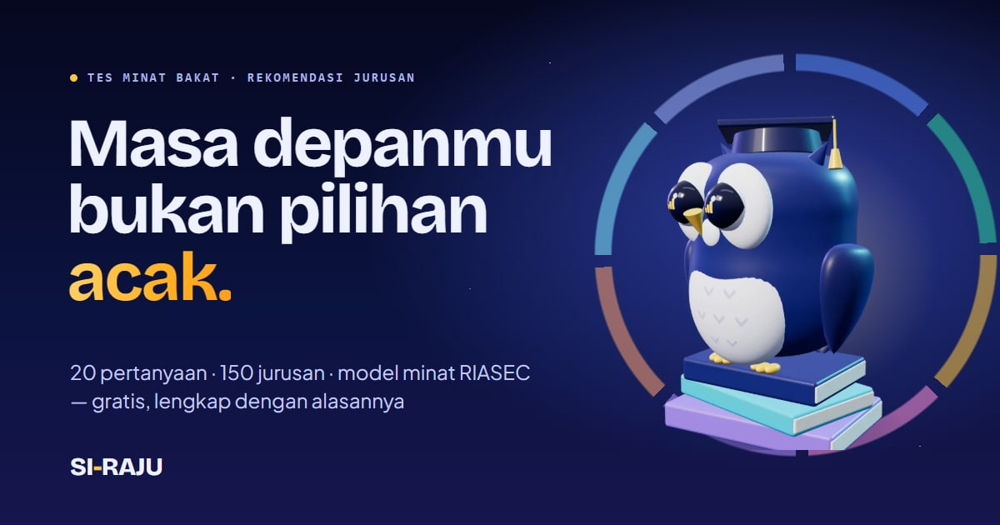
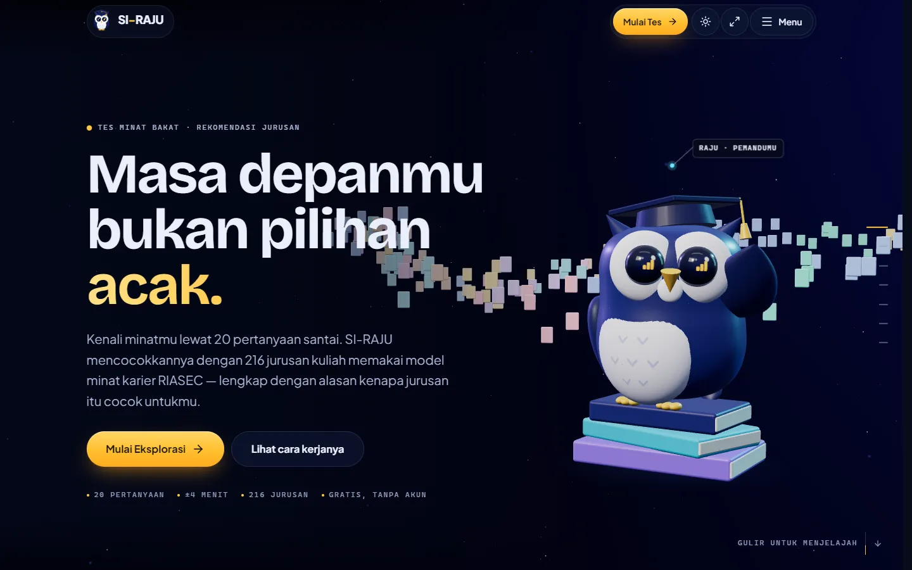
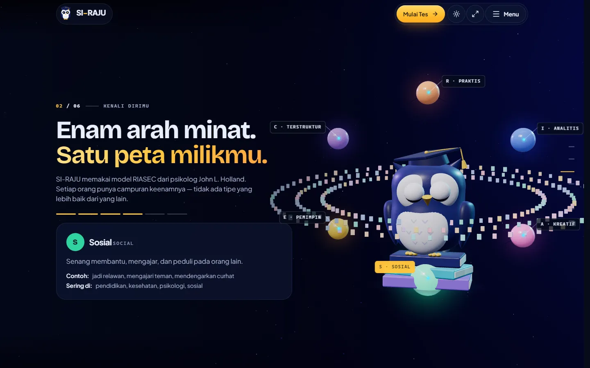
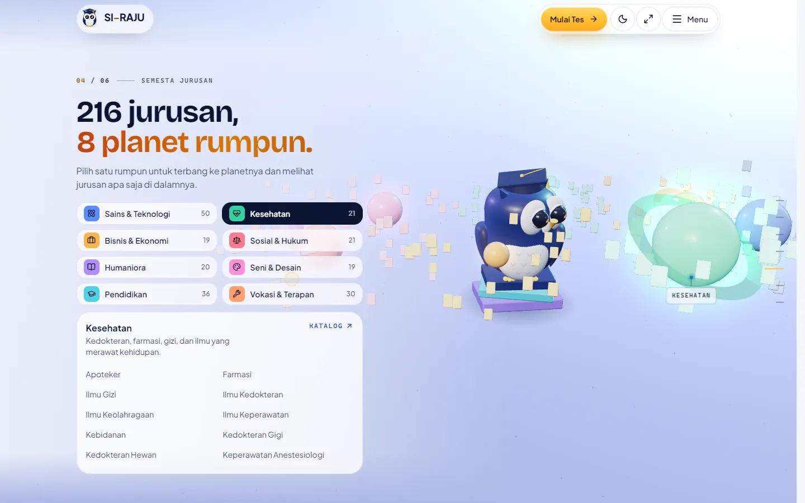
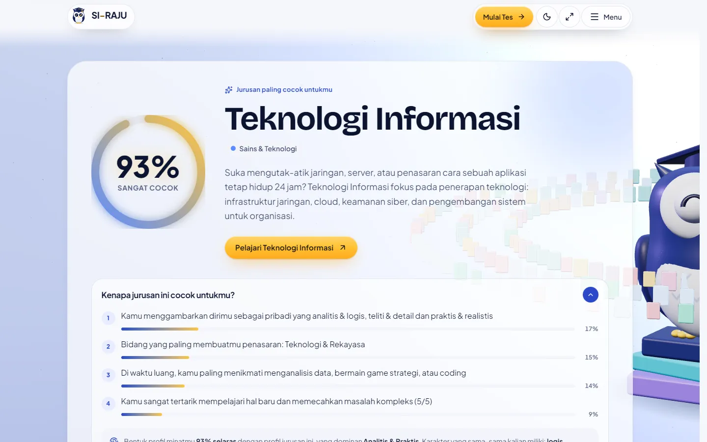
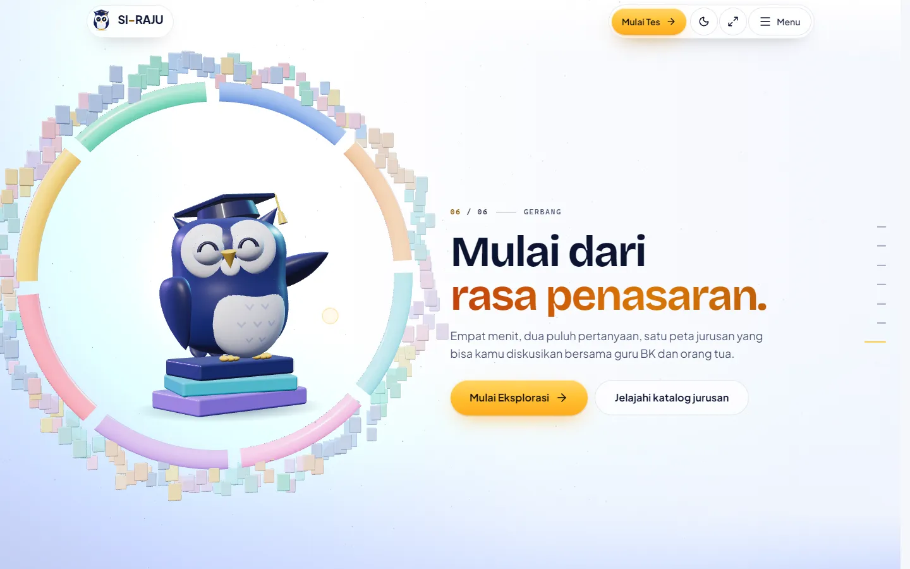
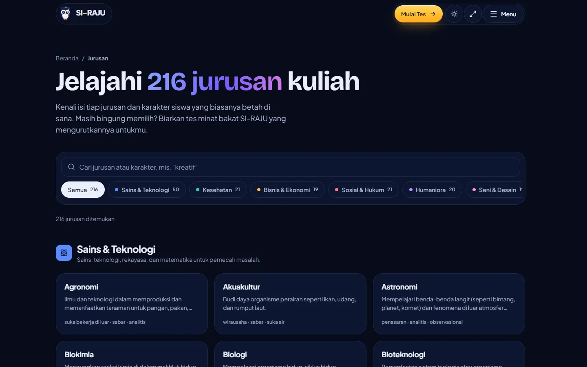
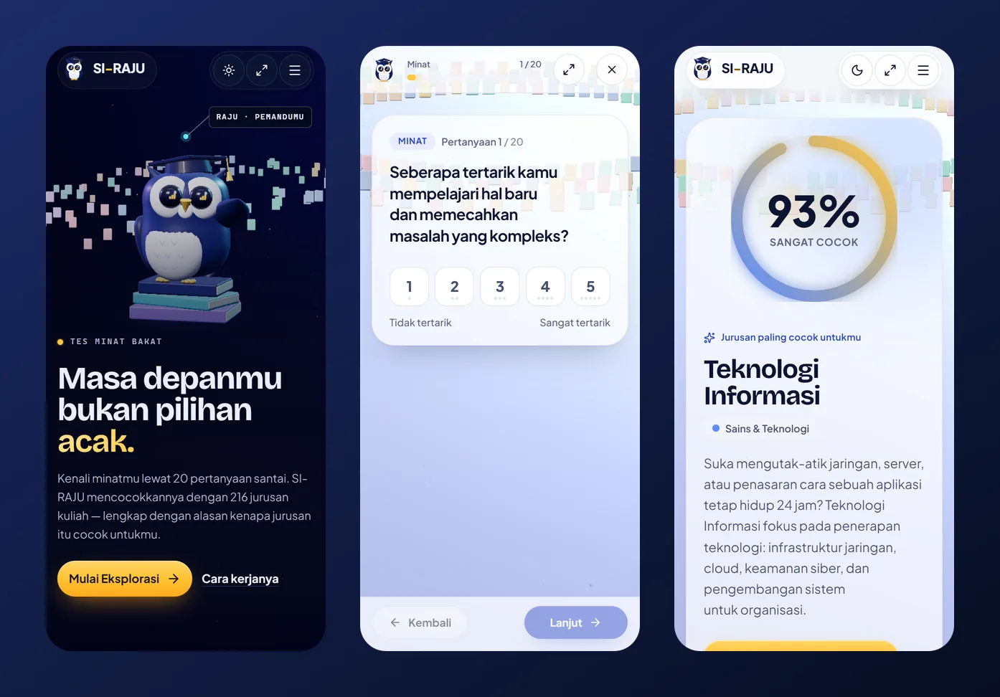
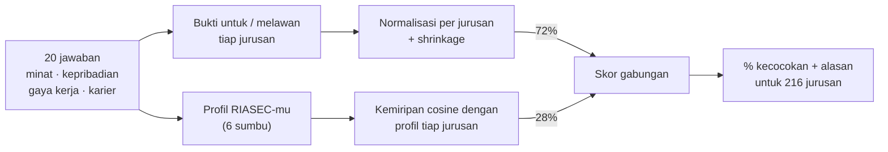

<div align="center">



# SI-RAJU · Sistem Rekomendasi Jurusan

**Tes minat bakat gratis yang mencocokkan siswa SMA/SMK dengan 216 jurusan kuliah di Indonesia — lengkap dengan alasan kenapa jurusan itu cocok.**

Dipandu **RAJU**, burung hantu 3D orisinal, lewat cerita scroll interaktif dan model minat karier **RIASEC (Holland)**.

[**🚀 Coba sekarang**](https://si-raju.vercel.app/) &nbsp;·&nbsp;
[GitHub Pages](https://syamaydev.github.io/react-sistemrekomendasijurusan/) &nbsp;·&nbsp;
[Katalog 216 jurusan](https://si-raju.vercel.app/jurusan/) &nbsp;·&nbsp;
[Cara kerja](#-cara-kerja-rekomendasi)


</div>

---

## ✨ Kenapa SI-RAJU?

Banyak siswa memilih jurusan karena ikut teman, tebakan, atau tekanan. SI-RAJU membantu memilih **berdasarkan minat sendiri**, dalam ±4 menit, tanpa daftar akun, dan **tanpa mengirim jawaban ke server**.

|  |  |
| --- | --- |
| 🎯 **Rekomendasi yang bisa dijelaskan** | Setiap hasil punya persentase kecocokan *dan* alasan terkuatnya (“Kamu sangat tertarik memecahkan masalah kompleks…”), lengkap dengan bobot tiap alasan. |
| 🧭 **Model RIASEC** | Jawabanmu membentuk profil enam tipe minat Holland — Praktis, Analitis, Kreatif, Sosial, Pemimpin, Terstruktur — yang dibandingkan dengan profil tiap jurusan. |
| 🇮🇩 **216 jurusan nyata di Indonesia** | S1, D3/D4, dan Sarjana Terapan dalam 8 rumpun — dari Teknik Informatika sampai Seni Kuliner, Nautika, Sastra Jawa, dan PGMI. Tiap jurusan punya halaman sendiri. |
| 🦉 **Cerita 3D “Semesta RAJU”** | Halaman utama adalah cerita scroll 7 babak dalam satu dunia 3D yang hidup: 216 kartu jurusan berubah formasi, 8 planet rumpun bisa dijelajahi. |
| 🔒 **Privat sejak awal** | Seluruh perhitungan berjalan di browser. Link hasil hanya berisi kode jawaban ringkas (tanpa isian bebas). |
| 💬 **SI-RAJU AI** | Asisten chat (Google Gemini) yang bisa membahas hasil tesmu — opsional; hasil tes hanya ikut terkirim jika kamu memintanya. |
| ⚡ **Cepat & aksesibel** | Lighthouse 100 di semua kategori, bisa dipakai penuh dengan keyboard & pembaca layar, menghormati *reduced motion*, tema terang/gelap. |

## 📸 Tampilan

| Beranda — cerita 3D | Enam arah minat (RIASEC) |
| --- | --- |
|  |  |
| **Semesta jurusan — 8 planet rumpun** | **Hasil — persentase & alasannya** |
|  |  |
| **Gerbang — mulai tes** | **Katalog 216 jurusan** |
|  |  |

<p align="center"></p>

## 🧠 Cara kerja rekomendasi



1. **Bukti sadar-opsi.** Tiap jawaban memberi bukti positif atau negatif untuk tiap jurusan sesuai opsi yang dipilih — memilih “berkarya seni” tidak ikut menaikkan Teknik Mesin.
2. **Adil untuk semua jurusan.** Bukti dibagi dengan bukti maksimum yang *mungkin* diterima jurusan itu, ditambah *shrinkage* agar jurusan dengan sedikit data tidak menang karena kebetulan.
3. **Bentuk minat.** Jawaban juga membentuk profil RIASEC yang dibandingkan (cosine) dengan profil tiap jurusan dari karakter yang cocok dengannya.
4. **Dijelaskan, bukan diramal.** Skor gabungan dikalibrasi menjadi persentase yang jujur (20–98%), dan `explain()` mengurutkan alasan terkuat beserta porsinya.

Mesinnya murni (tanpa React/I/O) di [`src/lib/engine.js`](src/lib/engine.js) dan diuji dengan profil siswa nyata — mulai dari calon programmer sampai calon koki pastry dan pencinta budaya Jawa.

## 🗂️ 216 jurusan dalam 8 rumpun

| Rumpun | Jumlah | Contoh |
| --- | :---: | --- |
| 🔬 Sains & Teknologi | 50 | Teknik Informatika, Sains Data, Teknik Robotika dan Kecerdasan Buatan, Oseanografi |
| 🎓 Pendidikan | 36 | PGSD, Pendidikan Tata Boga, Pendidikan Bahasa Arab, PGMI, Pendidikan IPA |
| 🛠️ Vokasi & Terapan | 30 | Tata Boga, Seni Kuliner, Patiseri, Nautika, Teknologi Game, Teknik Mekatronika |
| 🩺 Kesehatan | 21 | Pendidikan Dokter, Farmasi, Teknologi Laboratorium Medis, Radiologi, Terapi Wicara |
| ⚖️ Sosial & Hukum | 21 | Psikologi, Ilmu Hukum, Ilmu Komunikasi, Hukum Ekonomi Syariah |
| 📚 Humaniora | 20 | Sastra Inggris, Ilmu Sejarah, Sastra Jawa, Sastra Sunda, Ilmu Al-Qur'an dan Tafsir |
| 🎨 Seni & Desain | 19 | DKV, Arsitektur, Film dan Animasi, Fotografi, Seni Karawitan |
| 💼 Bisnis & Ekonomi | 19 | Manajemen, Akuntansi, Bisnis Digital, Perbankan Syariah, Manajemen Logistik |

Setiap jurusan punya halaman statis yang bisa diindeks mesin pencari (deskripsi, karakter yang cocok, profil RIASEC, jurusan serumpun) — dan, kalau kamu sudah tes, persentase kecocokanmu dengan jurusan itu.

## 🧰 Teknologi

| Bagian | Dipakai |
| --- | --- |
| UI & routing | React 19 · React Router 7 |
| Build & render | Vite 7 · prerender statis per halaman (`react-dom/static`), CSS di-*inline*, CSP otomatis |
| Gaya & animasi | Tailwind CSS 4 · Motion · animasi scroll berbasis variabel CSS |
| 3D | three.js r182 · React Three Fiber 9 · Drei — RAJU dibuat prosedural, tanpa aset pihak ketiga |
| Kualitas | Node test runner · ESLint 9 · Lighthouse |
| AI chat | Google Gemini lewat backend serverless terpisah (`si-raju-backend`) — API key tidak pernah ada di frontend |

## 🚀 Mulai cepat

Butuh **Node.js 20.19+ atau 22.12+** (syarat Vite 7).

```bash
git clone https://github.com/SyamayDev/react-sistemrekomendasijurusan.git
cd react-sistemrekomendasijurusan
npm install
npm run dev          # http://localhost:5173/react-sistemrekomendasijurusan/
```

| Perintah | Fungsi |
| --- | --- |
| `npm run dev` | Server pengembangan dengan HMR |
| `npm test` | Unit test mesin rekomendasi & konsistensi data |
| `npm run lint` | ESLint |
| `npm run build` | Build klien + SSR, lalu prerender 224 halaman ke `dist/` |
| `npm run preview` | Pratinjau hasil build |
| `npm run deploy` | Build lalu publish `dist/` ke GitHub Pages |
| `npm run raju:export` | Render ulang poster RAJU & ekspor `raju.glb` |

Saat `npm run dev`, endpoint `/api/chat` dilayani dari proyek backend di sebelahnya (`../Backend-SistemRekomendasiJurusan`) memakai `GEMINI_API_KEY` dari `.env.local` backend.

## 🌐 Deploy

Situs ini 100% statis, jadi bisa di-host di mana saja. Satu hal yang penting: **base path**.

| Host | URL | Base path |
| --- | --- | --- |
| GitHub Pages | `syamaydev.github.io/react-sistemrekomendasijurusan/` | `/react-sistemrekomendasijurusan/` (default) |
| Vercel | `si-raju.vercel.app/` | `/` — dipilih otomatis karena Vercel menyetel `VERCEL=1` saat build |
| Domain sendiri / host lain | `domainmu.com/` | setel `BASE_PATH=/` |

> [!IMPORTANT]
> Kalau base path tidak cocok dengan alamat situs, HTML tetap tampil tetapi semua JavaScript, CSS, font, dan gambar menjadi 404 — halaman terlihat “rusak” dan layar muat 3D macet di 0%. Pastikan build untuk root domain memakai `BASE_PATH=/` (Vercel sudah otomatis).

**Variabel lingkungan (opsional)**

| Variabel | Default | Kegunaan |
| --- | --- | --- |
| `BASE_PATH` | `/react-sistemrekomendasijurusan/` (`/` di Vercel) | Base path deploy |
| `VITE_SITE_URL` | URL GitHub Pages | URL kanonis untuk SEO, sitemap, dan Open Graph |
| `VITE_CHAT_API_URL` | `https://si-raju-backend.vercel.app/api/chat` | Endpoint chat AI (juga dipakai di CSP) |

## 🏆 Kualitas

**Lighthouse** (build produksi, diukur lokal):

| Halaman | Performa | Aksesibilitas | Best practices | SEO |
| --- | :---: | :---: | :---: | :---: |
| Beranda (ponsel & desktop, termasuk 3D penuh) | 100 | 100 | 100 | 100 |
| Tes | 100 | 100 | 100 | 100 |
| Katalog jurusan | 100 | 100 | 100 | 100 |
| Halaman jurusan | 100 | 100 | 100 | 100 |

- **Aksesibilitas:** semua aksi 3D punya kontrol nyata (tombol, chip, tautan); grafik radar punya tabel data untuk pembaca layar; menu menjebak fokus dan menutup dengan Esc; *reduced motion* mengganti dunia 3D dengan ilustrasi statis.
- **Responsif:** diuji di 360, 390, 768, 1280, dan 1440 px — tanpa scroll ke samping.
- **Tanpa 3D pun lengkap:** tanpa WebGL, di GPU software, atau dengan *reduced motion*, cerita tetap utuh dengan poster RAJU yang dirender dari model yang sama.
- **Test:** 21 unit test menjaga mesin rekomendasi, kode share, pencocokan hobi, dan konsistensi data (jumlah per rumpun, insight tiap jurusan, karakter yang terpetakan ke RIASEC).

## 📁 Struktur proyek

```
src/
  main.jsx              entry mungil: tunggu first paint → muat React → hidrasi
  boot.jsx / App.jsx    shell aplikasi, rute, transisi
  entry-server.jsx      renderer prerender (dipakai scripts/prerender.mjs)
  lib/                  engine.js (mesin rekomendasi + test), riasec, hobbies, seo,
                        sceneStore (DOM ↔ 3D), scrollStory, loader3d, …
  data/                 majors.json · questions.json · insights.json · faq.js
  pages/                Home · Quiz · Result · Majors · MajorDetail · About · Privacy
  components/
    story/              7 babak cerita scroll + StoryRail
    three/              Stage (kanvas R3F, lazy) · world/ (formasi, kamera, planet) · raju/ (model + animator)
    quiz/ result/ chat/ layout/ ui/ home/
scripts/prerender.mjs   SSG: HTML per rute, CSS inline, CSP, sitemap.xml, robots.txt, 404.html
scripts/raju-export.mjs poster RAJU (.webp) + raju.glb dari model prosedural
docs/screenshots/       gambar untuk README ini
```

## 🔍 Di balik layar

<details>
<summary><b>Cerita scroll & dunia 3D</b></summary>

- `lib/scrollStory.js` mengukur tiap babak (`section[data-chapter]`, panggung *sticky*) sekali saat resize, lalu tiap scroll (satu rAF) menulis progres kontinu `story` (babak *i* = `[i, i+1)`) ke `sceneStore` dan variabel CSS `--enter`/`--p` + `data-step`. React tidak dirender ulang saat scroll.
- `components/three/world/buildWorld.js` membaca `story` setiap frame: kamera & RAJU mengikuti *keyframe* per babak; satu kartu per jurusan (satu `InstancedMesh`) berubah formasi: halo → kekacauan → orbit → dinding data → gugus di 8 planet rumpun → bingkai gerbang. Ukuran kartu, grid dinding data, dan ukuran planet menyesuaikan jumlah jurusan.
- **Semesta jurusan:** cincin 8 planet berputar pelan; memilih rumpun memutar cincin lewat jalur terpendek sampai planet itu berada di depan, sedikit di kanan RAJU. Planet yang melintas tepat di depan RAJU mengecil, jadi RAJU tidak pernah tertutup.
- Di tata letak bertumpuk (ponsel/tablet), panel teks tiap babak diukur dan dunia 3D dibingkai otomatis di ruang kosong di atasnya (jarak kamera + *lens shift*).
- Label HUD di objek 3D bersifat dekoratif (`aria-hidden`); semua aksinya juga tersedia sebagai kontrol nyata.
- **Akhir cerita:** saat babak Gerbang bergulir keluar, dunia 3D memudar (`--story-out`) dan bagian atas FAQ bergradasi dari langit, tanpa garis batas.

</details>

<details>
<summary><b>Layar “Memuat Semesta” & kapan 3D dipakai</b></summary>

- Tampil sejak first paint dan baru terangkat setelah dunia 3D benar-benar tergambar — pengunjung tidak pernah melihat adegan setengah jadi.
- Progresnya nyata: dua unduhan dihitung per byte (daftar chunk + ukuran disisipkan prerenderer di `<meta name="siraju:3d">`), lalu langkah model, pencahayaan, dan shader (`lib/loader3d.js`, `components/layout/Preloader.jsx`).
- Tes selalu bisa dimulai lewat “Langsung mulai tes”; bila gagal/timeout tampil “Coba lagi” / “Lanjut tanpa 3D” (hanya untuk kunjungan itu).
- 3D selalu dipakai bila perangkat punya GPU (perangkat spek rendah mendapat resolusi render lebih ringan). Pengecualian: *reduced motion*, tanpa WebGL, atau WebGL berbasis software (SwiftShader/llvmpipe).
- Untuk dukungan/pengujian: `?3d=on` memaksa 3D, `?3d=off` melewatinya — berlaku per tab.

</details>

<details>
<summary><b>Navigasi tanpa bilah atas</b></summary>

Tidak ada top bar agar dunia 3D memakai seluruh layar: logo di pil kiri atas, aksi di pil kanan atas (Mulai Tes · tema · layar penuh · Menu). Navigasi ada di **menu layar penuh** (`components/layout/Header.jsx`: halaman dan tujuh bab cerita, masing-masing dengan ikon, serta sakelar tampilan) yang menjebak fokus, menutup dengan Esc, dan membuat halaman di belakangnya `inert`. Tombol layar penuh memakai Fullscreen API dan disembunyikan di peramban yang tidak mendukung (mis. Safari iPhone).

</details>

<details>
<summary><b>RAJU 3D & pipeline aset</b></summary>

RAJU adalah model **orisinal yang dibangun prosedural dengan three.js** ([`createRaju.js`](src/components/three/raju/createRaju.js)) — tanpa model, tekstur, atau HDRI pihak ketiga. Proporsi (profil *lathe* badan), warna (`RAJU_COLORS`), ekspresi (`EXPRESSIONS`), dan rig (kepala, kelopak mata, sayap, kuncir toga) semuanya ada di file itu; `createRajuAnimator` mengatur napas, kedip, tatapan, kepak, dan lambaian.

```bash
npm run dev          # lalu buka /react-sistemrekomendasijurusan/tools/raju/viewer.html?pose=hero&spin=1
npm run raju:export  # render ulang poster src/assets/raju/*.webp + ekspor assets-src/raju/raju.glb
```

- Pose viewer: `hero`, `curious`, `wave`, `happy`, `thinking`, `front`, `side`, `back`, `poster-*`; parameter `size`, `bg=1`, `perch=0`, `spin=1`.
- `raju:export` butuh Chrome/Edge lokal (atau `CHROME_PATH`). `raju.glb` (~1,5 MB, tidak di-deploy) bisa dibuka di Blender/AR viewer.
- Pencahayaan juga prosedural (`world/environment.js`: *softbox* + PMREM) dan dipakai bersama oleh situs maupun viewer, jadi poster sama dengan versi live.

</details>

<details>
<summary><b>Catatan performa</b></summary>

- Setiap halaman diprerender; CSS (~14 KB gzip) di-*inline* sehingga first paint hanya butuh HTML.
- JavaScript dimuat **setelah first paint** dan dievaluasi bertahap (React DOM → aplikasi → hidrasi dalam transition).
- Dunia 3D (three.js ~150 KB br + kode dunia ~63 KB br, chunk terpisah) dimuat di balik layar “Memuat Semesta”; penyiapannya dipecah ke beberapa *task* dan shader dikompilasi paralel (`KHR_parallel_shader_compile`), jadi halaman tidak membeku. Render loop berhenti saat panggung cerita tidak terlihat.
- Font judul (Bricolage Grotesque) dan isi (Plus Jakarta Sans) di-*preload*; *fallback* lokal disetel ukurannya agar tidak terjadi pergeseran tata letak.
- Library Motion hanya dimuat di rute yang membutuhkannya.

</details>

## ➕ Menambah jurusan

Semua jurusan ada di [`src/data/majors.json`](src/data/majors.json). Untuk menambah jurusan baru:

1. **`majors.json`** — tambahkan di akhir dengan `id` berikutnya (`m217`, …). Isi nama resmi program studi, rumpun, deskripsi singkat (sebut jenjang D3/D4 bila vokasi), dan 4–5 `karakter_cocok` dari kosakata `TRAIT_MAP` di [`lib/riasec.js`](src/lib/riasec.js). Id lama jangan diubah karena menjadi kunci bobot di `questions.json` dan `hobbies.js`.
2. **`insights.json`** — paragraf “kenapa cocok”, dengan kunci = `nama_jurusan` persis.
3. **`questions.json`** — bobot jurusan itu di soal skala/ya-tidak (`bobot_jurusan`) dan di opsi yang relevan (`efek.jurusan`). Cara termudah: turunkan dari 1–3 jurusan lama yang paling mirip.
4. **Opsional:** kata kunci hobi di [`lib/hobbies.js`](src/lib/hobbies.js); lalu perbarui `jumlah` di [`lib/categories.js`](src/lib/categories.js) dan angka di deskripsi `index.html`.

Lalu jalankan `npm test` — test akan gagal kalau ada yang tidak sinkron, dan memastikan profil siswa tertentu (calon koki/pastry, pencinta budaya Jawa, calon guru agama, pencinta wisata, montir) benar-benar menemukan jurusan yang dimaksud.

## 🔒 Privasi

- Jawaban tes diproses **sepenuhnya di browser** dan disimpan hanya di `localStorage` perangkatmu.
- Link berbagi hasil berisi kode jawaban ringkas, **tanpa** isian bebas (hobi).
- Chat AI bersifat opsional: pesanmu dikirim ke backend hanya saat kamu mengirimnya, dan ringkasan hasil tes ikut terkirim hanya jika kamu menekan “Tanya AI soal hasil ini” (konteksnya bisa dihapus kapan saja). API key ada di server, tidak pernah di frontend.
- Tanpa akun, tanpa iklan, tanpa pelacak pihak ketiga.

## 📜 Aset & lisensi

| Aset | Sumber | Lisensi |
| --- | --- | --- |
| Model RAJU 3D, poster `src/assets/raju/*`, tekstur mata/perut (canvas) | Dibuat khusus untuk proyek ini (prosedural) | Mengikuti repositori ini |
| Ilustrasi burung hantu lama (`owl-*.webp`, maskot SVG) | Aset SI-RAJU | Mengikuti repositori ini |
| Font Plus Jakarta Sans, Bricolage Grotesque | Fontsource (`@fontsource-variable/*`) | SIL Open Font License 1.1 |
| three.js, React Three Fiber, Drei | npm | MIT |
| Ikon lucide | npm | ISC |

Kode dan aset orisinal © 2026 Syahril Maymubdi ([@SyamayDev](https://github.com/SyamayDev)). Pustaka pihak ketiga mengikuti lisensinya masing-masing.

---

<div align="center">

Dibuat dengan 🦉 oleh **[Syahril Maymubdi](https://github.com/SyamayDev)** untuk siswa Indonesia yang sedang memilih jalan.

**Masa depanmu bukan pilihan acak.**

[Mulai tes →](https://si-raju.vercel.app/tes/)

</div>
